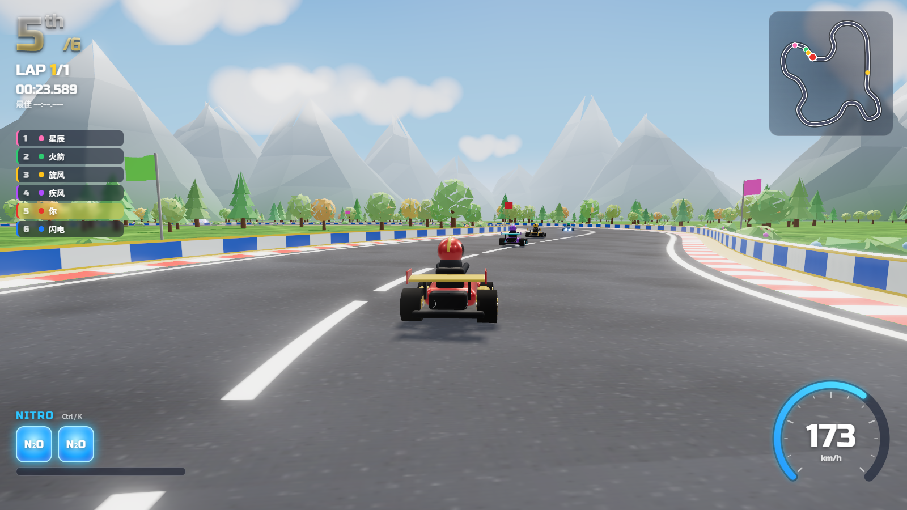
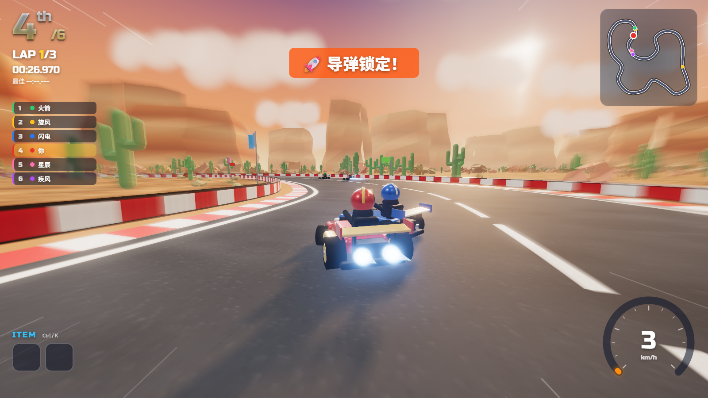
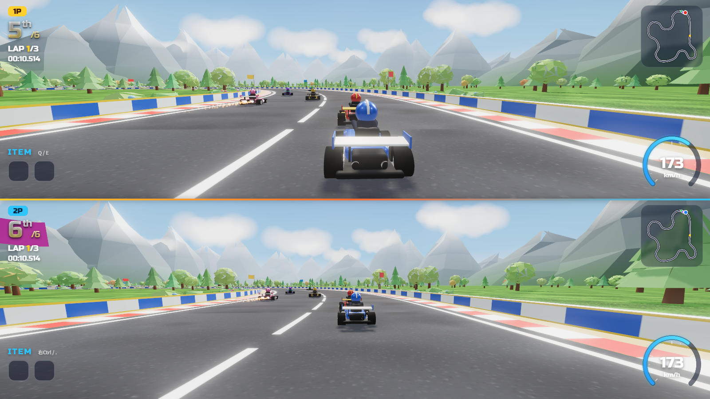
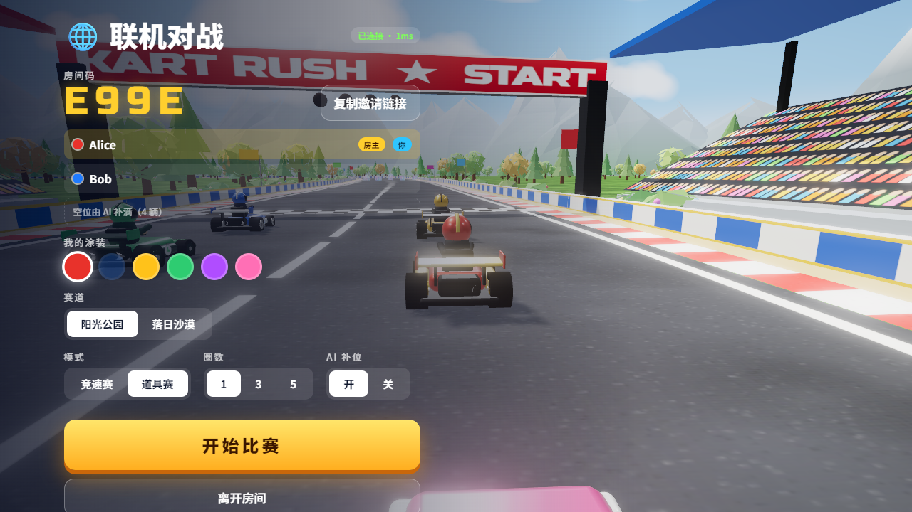

# Kart Rush · 极速卡丁

跑跑卡丁车风格的浏览器 3D 竞速游戏，支持**单人、本地双人分屏和线上多人联机**。

Vite + TypeScript + Three.js 编写。所有模型、贴图、音效和背景音乐都在代码里程序化生成，**没有任何外部美术或音频资源**。

**在线试玩：https://kart.predix.icu**



| 落日沙漠 · 道具赛 | 本地双人分屏 |
| --- | --- |
|  |  |

## 特色

- **两条赛道**：阳光公园（草地松林、大发夹弯）、落日沙漠（夕阳峡谷、仙人掌、台地，高速弯多）
- **两种模式**
  - 竞速赛：漂移积攒氮气槽，满了得一个氮气（最多 2 个）
  - 道具赛：道具箱随机给道具，名次越靠后越容易拿到强力道具
- **漂移手感**：漂移越久火花越亮（蓝 → 橙），松开获得小喷加速；倒计时起步加速；加速带
- **5 位 AI 对手**：会走线、漂移、放氮气、用道具，带追赶机制，比赛始终胶着
- **本地双人分屏**：上下分屏，各自独立的相机、HUD、小地图
- **线上联机**：创建房间、分享链接，最多 6 人，空位可由 AI 补满
- **画面**：PBR 车漆、软阴影、MSAA、Bloom、加速径向模糊、速度线、粒子（烟雾 / 火花 / 尾焰）
- **声音**：WebAudio 实时合成引擎声、漂移声、道具音效和背景音乐
- 支持手柄

### 道具

| 道具 | 效果 |
| --- | --- |
| 🚀 导弹 | 追踪前一名，命中使其打转减速 |
| 💧 水炸弹 | 抛向前方，落地形成水域，开进去的对手被困在水泡里 |
| 🍌 香蕉皮 | 丢在身后，撞上的车打转 |
| 🛡️ 护盾 | 6 秒内抵挡一次攻击 |
| ⚡ 氮气 | 立即加速 |

## 快速开始

需要 Node.js 18+。

```bash
npm install
npm run dev        # 打开 http://localhost:5173
```

单人和本地双人不需要后端。要在本地试联机，另开一个终端启动房间服务器：

```bash
cd server
npm install
npm start          # 监听 127.0.0.1:8790，Vite 开发服务器会把 /ws 代理过去
```

然后用两个浏览器窗口（或一个普通窗口 + 一个无痕窗口）打开页面，一个创建房间，另一个用房间码加入。

## 操作

| | 单人 | 双人 1P | 双人 2P |
| --- | --- | --- | --- |
| 驾驶 | 方向键 / WASD | WASD | 方向键 |
| 漂移（按住 + 方向） | Shift / Space | 左 Shift / Space | 右 Shift / `/` |
| 氮气 / 道具 | Ctrl / K | Q / E | 右 Ctrl / `.` |
| 回到赛道 | R | R | `\` |

通用：P 暂停，M 音乐开关，C 切换视角，Enter 开始。手柄 1 → 1P，手柄 2 → 2P（RT 油门、LT 刹车、LB/RB 漂移、X/B 道具）。

## 联机实现



后端（`server/index.mjs`）是一个很小的 Node.js + [ws](https://github.com/websockets/ws) 房间服务，前端相关代码在 `src/net.ts`、`src/lobby.ts`。采用**客户端权威 + 服务器中继**的方式：

- 服务器只管房间、开赛和官方冲线名次；每个客户端模拟自己的车，以 20Hz 广播状态，房主额外模拟 AI 车
- 远端赛车用最新状态做航位推算 + 平滑插值，看起来不卡顿
- 道具发射事件全房间广播，**是否命中由被击中方的客户端判定**，避免“明明躲开了却被判中”；道具箱拾取同步
- 房主中途离开会自动转移房主，由新房主接管 AI

这种方式实现简单、服务器几乎没有负载，适合和朋友开黑；它不防作弊，不适合公开排位。

## 部署

1. 构建前端：`npm run build`，把 `dist/` 放到任意静态文件服务器。
2. 在服务器上运行房间服务：

   ```bash
   cd server && npm ci --omit=dev
   PORT=8790 HOST=127.0.0.1 node index.mjs
   ```

3. 让同域名的 `/ws` 路径反向代理到房间服务（前端固定连接 `当前域名/ws`）。以 [Caddy](https://caddyserver.com/) 为例：

   ```caddy
   kart.example.com {
       encode zstd gzip
       handle /ws* {
           reverse_proxy 127.0.0.1:8790
       }
       handle {
           root * /var/www/kart
           file_server
       }
   }
   ```

   房间服务只需要监听本机端口，经 443 转发，不用额外开放防火墙端口。生产环境建议用 systemd / pm2 守护进程。

## URL 参数（调试 / 演示）

`?track=1` 沙漠赛道 · `?items` 道具赛 · `?2p` 双人 · `?auto` AI 代驾玩家赛车 · `?room=CODE` 直接进入联机房间 · `?debug` 暴露 `window.game`

## 代码结构

```
src/
  game.ts        主循环、状态机、世界构建、多视图渲染（分屏）、道具与联机逻辑、比赛流程
  themes.ts      赛道布局 + 视觉主题定义（新增赛道只需加一项）
  track.ts       赛道样条、路面 / 路肩 / 护栏网格、投影与加速带
  kart.ts        赛车物理：加速、转向、漂移、氮气、撞墙、被击中状态、圈数、网络状态同步
  kartModel.ts   程序化卡丁车、车手、护盾 / 水泡、名字标签
  weapons.ts     导弹、水炸弹、水域、香蕉皮
  ai.ts          AI 驾驶（走线、漂移、避让）
  scenery.ts     天空、地面、植被（森林 / 沙漠）、远山 / 台地、云、拱门、看台、旗帜、道具箱
  particles.ts   GPU 点精灵粒子
  audio.ts       WebAudio 合成音效与背景音乐
  hud.ts         HUD（可多实例）、小地图、速度表、道具栏
  input.ts       键盘 / 手柄输入，单人与双人键位
  net.ts         WebSocket 客户端
  lobby.ts       联机大厅界面
  textures.ts    Canvas 程序化贴图
server/
  index.mjs      联机房间服务
```

### 添加一条新赛道

在 `src/themes.ts` 的 `TRACKS` 数组里加一项：控制点（闭合样条）、加速带和道具箱的位置、视觉主题（天空、雾、地面、植被、远山等）。菜单和联机大厅会自动出现这条赛道。建议最小弯道半径大于 20 米，赛道不同路段之间保持 35 米以上的间距，避免护栏重叠。

## 许可证

[MIT](LICENSE)
